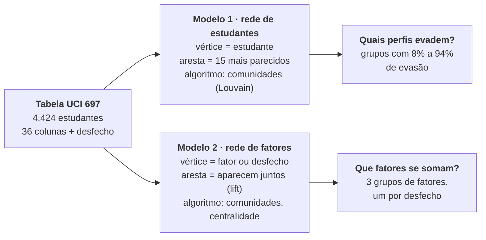

# Entendendo o trabalho de Grafos — Cenário 3: Evasão Estudantil

*Atualizado em 10/11/2026*

## Em uma frase

**O trabalho pede que o grupo pegue dados reais de estudantes, transforme esses dados em um grafo e use algoritmos de grafos para descobrir quais perfis de estudante tendem a evadir e quais tendem a se formar.**

A ideia central do tema é que a evasão quase nunca tem uma causa só. Uma tabela mostra cada variável isolada (nota, renda, idade). Um grafo mostra as *relações*: quais estudantes são parecidos entre si e quais fatores aparecem juntos. O grupo entrega três coisas até 22/11: um relatório de até 9 páginas, os slides de uma apresentação de cerca de 15 minutos e o código do protótipo no GitHub.

## O que a disciplina pede

O projeto de SMAC03 (Prof. Rafael Frinhani) avalia se o grupo consegue aplicar teoria dos grafos a um problema real, do entendimento até a validação. Segundo as *Diretrizes do Projeto 2026.2*, o grupo é avaliado em quatro capacidades:

1. **Entender** o problema do cenário sorteado.
2. **Modelar** o problema como grafo e escolher métodos de grafos para resolvê-lo.
3. **Desenvolver** um protótipo de software que recebe o dataset e devolve a solução. Interface gráfica é opcional; o que importa é o núcleo algorítmico.
4. **Validar** o método e discutir resultados, limitações e melhorias.

O trabalho é em grupo, mas a nota é individual. Todos precisam apresentar, e o relatório tem de deixar claro o papel de cada um.

| Papel | Quantos | O que faz |
| --- | --- | --- |
| Coordenador | 1 | Cronograma, reuniões, aderência às diretrizes, repositório GitHub, organização do relatório e dos slides, contato com o professor |
| Modelador | 2 | Entender o domínio, curar o dataset, definir vértices, arestas e pesos, formular hipóteses, interpretar os resultados |
| Desenvolvedor | 2 | Arquitetura do protótipo, implementar os algoritmos, testes e validação quantitativa, preparar a demonstração |

Cada atividade crítica precisa de um responsável principal e de um corresponsável (Tabela 1 das diretrizes).

**Estrutura do relatório**, com o máximo de páginas por seção:

| Seção | Máximo | O que vai nela |
| --- | --- | --- |
| 1. Introdução | 1 pág. | Contexto, problema, lacuna, questão de pesquisa, hipóteses, justificativa, objetivos |
| 2. Referencial Teórico | 1 pág. | Conceitos de grafos usados e trabalhos parecidos |
| 3. Metodologia | 2 pág. | 3.1 Modelagem (dataset e modelo do grafo) e 3.2 Método de solução (algoritmos, código, diagramas) |
| 4. Resultados | 2 pág. | Resultados e discussão |
| 5. Conclusões | 1,5 coluna | O que foi respondido, contribuições, trabalhos futuros |

O limite total é de 9 páginas, contando capa e contracapa, no template LaTeX da disciplina. Figuras, diagramas e gráficos são obrigatórios para explicar o problema e o método.

## O que o tema (Cenário 3) diz

O tema é **"Trajetórias Acadêmicas: Modelagem da Evasão e do Sucesso Estudantil"**. Ele parte de um problema de gestão: coordenações e pró-reitorias têm recursos limitados e precisam decidir *quem* acompanhar, *quais sinais* anunciam o abandono e *que ações* têm mais chance de funcionar.

**O problema que o professor aponta.** Os relatórios atuais olham cada variável separadamente: média de notas, renda familiar, distância da residência, número de reprovações. Eles respondem *quanto* cada fator pesa, mas não *como os fatores se combinam*. Na prática, a evasão mistura dificuldade acadêmica, situação financeira, distância e contexto pessoal. Dois estudantes com o mesmo valor em um indicador podem seguir caminhos completamente diferentes.

**O desafio.** Transformar os registros dos estudantes em uma **representação relacional** (um grafo) que mostre grupos de perfis parecidos, dependências entre fatores e padrões que se repetem nas trajetórias.

**O que o grupo precisa investigar:**

- Como modelar os dados como grafo: o que são vértices, o que são arestas e quais relações capturam melhor a trajetória. Essa escolha é do grupo.
- Quais perfis e grupos estão associados a maior risco de evasão, e quais ao fracasso ou ao sucesso.
- Como comparar as estruturas de cada desfecho, incluindo perfis que *parecem* iguais e terminam de formas diferentes.
- O que o grafo revela que a análise de variáveis isoladas não revela.
- Como esses resultados podem apoiar ações de acompanhamento, prevenção e intervenção.

**Resultados esperados:** entender a evasão como problema relacional; um modelo formal do grafo, com as decisões justificadas; um protótipo funcional de análise e exploração; perfis de risco identificados; e uma discussão crítica dos resultados, das limitações dos dados e das aplicações na instituição. A validação precisa usar **métricas quantitativas** e interpretações educacionais coerentes.

## O que o dataset tem

O dataset indicado é o [UCI 697 – Predict Students' Dropout and Academic Success](https://archive.ics.uci.edu/dataset/697/predict+students+dropout+and+academic+success), publicado por Realinho et al. (2022). São **4.424 estudantes** de uma instituição pública de ensino superior de Portugal, de 17 cursos de graduação, com ingresso entre 2008/09 e 2018/19. É um único arquivo `data.csv`: uma linha por estudante, 36 colunas de informação e a coluna do desfecho. Não há valores ausentes.

**O desfecho (coluna `Target`)** é o que aconteceu com o estudante:

| Desfecho | Estudantes | % |
| --- | --- | --- |
| Graduate (formou-se) | 2.209 | 49,9% |
| Dropout (evadiu) | 1.421 | 32,1% |
| Enrolled (ainda matriculado) | 794 | 17,9% |

**As 36 colunas, agrupadas pelo que descrevem:**

| Grupo | Exemplos de colunas |
| --- | --- |
| Demográfico | Estado civil, nacionalidade, gênero, idade no ingresso, internacional, necessidades especiais |
| Ingresso | Forma de ingresso (1ª fase, maiores de 23, transferência…), ordem de opção, curso, turno (diurno/noturno), formação anterior e nota dela, nota de admissão |
| Socioeconômico | Escolaridade e ocupação da mãe e do pai, deslocado (mora longe), bolsista, devedor, mensalidade em dia |
| Desempenho no 1º e no 2º semestre | Disciplinas creditadas, inscritas, avaliadas, aprovadas, sem avaliação e média das notas |
| Macroeconômico | Taxa de desemprego, inflação e PIB no ano de ingresso |

**O que é preciso saber antes de usar:**

- Muitas colunas são **códigos**. A escolaridade dos pais, por exemplo, tem 29 códigos e o curso aparece como `9119`. É preciso traduzir e agrupar esses códigos; o grupo agrupou a escolaridade em 4 níveis e a forma de ingresso em 6.
- O arquivo usa **ponto e vírgula** como separador.
- Só há dados dos **dois primeiros semestres**. Não existe histórico disciplina a disciplina nem dos semestres seguintes.
- **Matriculado** é um desfecho em aberto: esse estudante ainda pode se formar ou evadir.
- Os dados são de **outro país e de outra instituição**, o que limita a generalização para a UNIFEI.
- As colunas macroeconômicas descrevem o ano, e não o estudante. Por isso o grupo decidiu não usá-las.

## Como isso vira um problema de grafos

O dataset é uma tabela, e tabela não tem arestas. **O trabalho de verdade é decidir o que liga com o quê.** O grupo montou dois grafos a partir da mesma tabela, cada um respondendo a uma pergunta do tema.

**Modelo 1 — rede de estudantes.** Cada vértice é um estudante. Cada estudante é ligado aos 15 mais parecidos com ele. A semelhança soma três partes com pesos: desempenho (50%), situação socioeconômica (30%) e perfil/ingresso (20%). Essa ideia vem do artigo do próprio professor (Porto et al., KDMiLe 2025), que fez algo parecido com candidatos a auxílio estudantil.

- Um detalhe importante: **o desfecho não é usado para montar o grafo.** Ele só entra depois, para conferir se estudantes parecidos de fato terminam do mesmo jeito.
- Em cima desse grafo rodam algoritmos de **detecção de comunidades** (Louvain, Fast Greedy, Label Propagation), que acham grupos de estudantes muito ligados entre si. Depois o grupo olha a taxa de evasão de cada comunidade. Resultado preliminar: as comunidades vão de 8% a 94% de evasão.

**Modelo 2 — rede de fatores.** Cada vértice é um fator, como "devedor = sim" ou "aprovação no 1º semestre = 0%", mais um vértice para cada desfecho. Dois fatores são ligados quando aparecem juntos nos mesmos estudantes mais do que o acaso explicaria.

- A medida dessa ligação é o *lift*: o quanto o par aparece junto a mais do que se fosse por acaso.
- Os vizinhos do vértice "Evasão" mostram quais fatores cercam o abandono. Resultado preliminar: os fatores se dividem em três grupos, cada um contendo exatamente um desfecho.

No diagrama abaixo, o caminho vai da tabela aos dois grafos e, de cada grafo, à pergunta do tema que ele responde.

## Entregas e datas

Tudo é entregue até **22/11/2026 às 23h59**. Entrega fora do prazo ou por e-mail fica sem nota, e quem não apresentar também fica sem nota.

| Entrega | Como | Onde está no repositório |
| --- | --- | --- |
| Relatório (.pdf) | Até 9 páginas, template LaTeX da disciplina; só um integrante envia pelo SIGAA | `relatorio/` (rascunho atual: 8 páginas) |
| Slides (.pdf ou .pptx) | Apresentação presencial de cerca de 15 min, com demo ao vivo ou em vídeo | `slides/apresentacao.pptx` |
| Código-fonte | Um único projeto no GitHub, com o endereço no relatório; slides, figuras e modelos também vão nele | [smac03-evasao-grafos](https://github.com/viniciusnreno/smac03-evasao-grafos) (privado) |

**Reuniões com o professor:** grupos 1 a 5 nas segundas (19/10 e 09/11) e grupos 6 a 11 nas terças (20/10 e 10/11). A falta na reunião do seu grupo conta como falta na disciplina. As datas das apresentações são sorteadas.

## Glossário rápido

| Termo | O que significa aqui |
| --- | --- |
| Vértice (nó) | Uma "coisa" do grafo: um estudante no Modelo 1, um fator no Modelo 2 |
| Aresta | Uma ligação entre dois vértices: "são parecidos" ou "aparecem juntos" |
| Peso | A força da ligação: o quanto são parecidos, ou o lift |
| k-NN | Ligar cada vértice aos k mais parecidos com ele; aqui, k = 15 |
| Comunidade | Grupo de vértices muito ligados entre si e pouco ligados ao resto |
| Modularidade (Q) | Nota de 0 a 1 de quão bem separadas as comunidades estão; quanto mais alta, melhor |
| Louvain, Fast Greedy, Label Propagation | Três algoritmos que encontram comunidades; o grupo compara os três |
| Homofilia | Tendência de semelhantes se ligarem; aqui, estudantes parecidos terminarem do mesmo jeito |
| Assortatividade (r) | Número que mede a homofilia: 0 é aleatório e 1 é totalmente separado. O resultado preliminar foi 0,39 |
| Lift | Quantas vezes dois fatores aparecem juntos a mais do que o acaso; acima de 1 indica associação |
| Centralidade | Medida de importância de um vértice na rede, como grau, intermediação ou PageRank |
| Propagação de rótulos | Prever o desfecho de um estudante pelo desfecho dos vizinhos dele no grafo |
| AUC | Nota de 0,5 (chute) a 1 (perfeito) de quão bem um escore separa quem evadiu de quem não evadiu |
| CRISP-NET | Roteiro de etapas para projetos de dados com redes, indicado pelo professor nos materiais |
